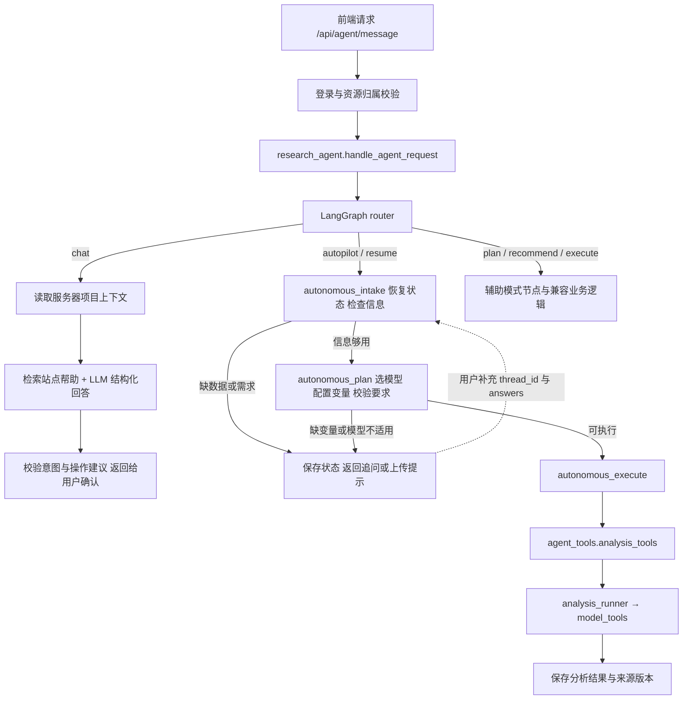

# MethodPal 后端与 Agent 代码指南

MethodPal 是面向社会科学研究的数据分析工作区。后端提供账户与项目管理、数据导入和编辑、变量配置、统计与机器学习分析、对话助手、图表与报告导出。它不是让大模型直接生成并执行任意 Python 的系统：LLM 负责理解与解释，经过校验的工作流负责调用真实分析工具。

本文对应仓库当前实现，是唯一的后端代码指南。FastAPI 中的版本标识为 `0.7.0`，实际行为以当前源码和测试为准。

## 1. Agent 主代码

这里有多个层次的“入口”，不只有一个文件：

| 文件 | 职责 | 修改场景 |
| --- | --- | --- |
| [main.py](main.py) | FastAPI 入口；路由、安全中间件、数据库迁移与后台任务生命周期 | 启动与全局配置 |
| [app/api/agent.py](app/api/agent.py) | 消息、追问续接、历史与状态 HTTP 接口 | 前后端接口 |
| [research_agent.py](app/services/research_agent.py) | **Agent 统一入口**；`handle_agent_request()` 根据 action / mode 分流 | 请求进入哪条流程 |
| [langgraph_agent/graph.py](app/services/langgraph_agent/graph.py) | **流程图定义**；节点连接与条件分支 | 执行顺序和分支 |
| [langgraph_agent/nodes.py](app/services/langgraph_agent/nodes.py) | 节点实现，连接业务函数 | 增加流程步骤 |
| [langgraph_agent/autonomous_workflow.py](app/services/langgraph_agent/autonomous_workflow.py) | **自动分析核心**；状态恢复、缺项检查、追问、选模型、变量配置、校验与执行 | 自动完成、中途继续、修改后重跑 |
| [conversation_agent.py](app/services/conversation_agent.py) | **LLM 对话核心**；可信项目上下文、帮助检索、LLM 调用与操作建议校验 | 工作台接待、网站问答、需求理解 |
| [llm_client.py](app/services/llm_client.py) | DeepSeek HTTP 调用、超时、结构化输出与错误分类 | 模型配置与调用故障 |

阅读顺序：main.py → api/agent.py → research_agent.py → graph.py / nodes.py → autonomous_workflow.py → agent_tools/ → analysis_runner.py → 对应 model_tools/ 文件。

优化“聊天不够灵活”，先看 conversation_agent.py；优化“信息齐全以后怎么自主分析”，先看 autonomous_workflow.py。模型计算不要写进 HTTP 路由或聊天提示词。

## 2. 实际执行流程



### 2.1 普通聊天：理解和建议，不直接改数据

`action="chat"` 优先于自动模式标记。即使界面处于自动模式，概念提问也不会自动触发分析。

conversation_agent.py 的主要步骤：

1. `conversation_context()` 从服务器读取当前账号可访问的项目、字段概况、分析摘要和最近对话。
2. `retrieve_help()` 从 [site_help.json](app/knowledge/site_help.json) 检索网站使用说明。
3. `generate_conversation()` 调用 LLM，要求返回包含 intent、reply 和候选模型/字段的 JSON。
4. `validated_response()` 校验项目、字段、模型和意图；返回有边界的操作建议，而不是执行模型生成的代码。

工作台可以回答“如何创建项目”“解释与预测有什么区别”等问题，不需要先上传数据。进入项目后，回答结合该项目的字段与已有结果。聊天建议中的分析操作需要用户确认，再进入分析流程；图表和报告请求不会被当作重跑模型。

当前 RAG 是**本地帮助文档的关键词/词元检索**，默认最多取 3 条，不是向量数据库或论文知识库。可以先扩展 JSON 中的 QA，再考虑语义检索。帮助内容被缓存，修改后需要重启服务或主动清缓存。

对话上下文不自动发送原始数据行、上传文件路径或密钥；仍会发送项目/字段名称、部分统计摘要，以及用户自己写在聊天里的内容。真实敏感研究数据需要评估第三方 LLM 的数据处理边界。

LLM 未配置、网络失败或返回格式不合法时，可能返回 `knowledge_fallback` 帮助降级，不代表分析成功。通过 source、llm_used、warnings 排查。部分结构化输出格式问题允许一次修复尝试；不要通过无限重试处理鉴权或余额错误。

### 2.2 自动分析：缺项追问 → 规划 → 执行

| 核心函数 | 职责 |
| --- | --- |
| `prepare_autonomous_intake()` | 检查数据、恢复研究目标与配置、处理明确变更；缺研究问题、分析目标、目标字段或关键类型时追问 |
| `prepare_autonomous_plan()` | 推荐与选择方法、补全必要变量角色、校验模型要求；不满足时追问或返回阻塞原因 |
| `execute_autonomous_plan()` | 调用真实分析工具、保存结果和项目状态；失败时保留方案并返回错误，不偷偷换模型 |

当前目标包括描述、解释变量关系、预测、群体比较与因果需求识别。**识别到因果需求，不等于已支持完整因果识别**：系统会确认范围，不能把普通回归、特征重要性或 SHAP 当成因果证据。

变量和模型选择目前主要依靠规则、字段分布、已保存配置及用户指定模型；LLM 对话可提出结构化需求，但不是无限制自主调用工具的循环。字段自动建议只是启发式，正式研究仍需核对变量含义和编码。

### 2.3 中途继续、重复点击与修改后重跑

- research_spec 保存研究问题、分析目标、目标字段及类型、自变量和控制变量等信息。
- 自动会话通过 thread_id 和项目内 AGENT_STATES 保存；追问回复通过 /api/agent/resume 的 answers 继续。
- 已完成后再次点击普通“自动完成”，若数据、模型、变量和参数仍匹配，会恢复有效结果，避免重复询问目标或重复训练。
- 明确输入“按当前方案重新运行”会绕过结果复用。修改模型、变量、参数或数据后需要重新校验；旧结果保留为历史，不能当成当前版本结果。
- [change_requests.py](app/services/langgraph_agent/change_requests.py) 支持一组明确表达，如“模型改为线性回归”“因变量改为收入”“自变量改为教育、年龄”“去掉变量年龄”“树数量改为100”。它不是任意自然语言编辑器；未匹配或字段不明确时要求补充。
- 数据内容通过数据工作区或数据转换的预览/确认接口修改，不让聊天直接执行任意数据操作。

持久化是应用自己维护的 SQLite 会话。graph.py 当前 `compile()` 没有配置 LangGraph checkpointer，也没有使用原生 interrupt 持久续接；追问再继续是应用层的状态恢复机制。

### 2.4 兼容文件与降级行为

- [executor.py](app/services/langgraph_agent/executor.py)：构造图状态并执行。LangGraph 无法导入时，使用本地节点执行器运行同一套新自动分析节点。
- [state.py](app/services/langgraph_agent/state.py)：定义一次图执行传递的 MethodPalGraphState，不是数据库表定义。
- [research_agent_legacy.py](app/services/research_agent_legacy.py)：保留辅助模式及旧逻辑；部分辅助节点仍委托它执行。
- [agent_orchestrator.py](app/services/agent_orchestrator.py)：旧 /api/chat 兼容聊天逻辑，不是当前 /api/agent/message 的主编排器。
- [tools.py](app/services/langgraph_agent/tools.py)：LangChain StructuredTool 包装。当前图节点主要直接调用业务函数，不是开放式 LLM tool-calling 循环。

默认 METHODPAL_AGENT_BACKEND=langgraph；显式设为 legacy 使用旧逻辑。排查新流程时不要用旧模式掩盖问题。新自动流程异常不会静默切换到旧自动分析或其他模型。

## 3. 后端目录

```text
backend/
├── main.py                     # Web 应用与生命周期
├── .env.example                # 不含凭据的本地配置模板
├── requirements*.txt           # 依赖与历史补丁增量清单
├── app/
│   ├── api/                    # HTTP 接口
│   ├── schemas/                # Pydantic 请求/响应约定
│   ├── knowledge/site_help.json # 网站帮助 QA
│   └── services/
│       ├── research_agent.py   # Agent 总入口
│       ├── conversation_agent.py
│       ├── langgraph_agent/    # 图、节点、自动工作流、变更规则
│       ├── agent_tools/        # Agent 业务工具
│       ├── model_tools/        # 各统计/机器学习模型的真实实现
│       ├── chart_tools/        # 图表推荐与规格生成
│       └── ...                 # 数据、账户、存储、报告等服务
├── scripts/                    # 迁移/管理脚本，执行前阅读用途
├── tests/                      # 回归与集成测试
└── storage/                    # 默认运行数据目录，不提交 Git
```

## 4. 各类工具代码

### 4.1 Agent 业务工具

| 模块 | 作用 |
| --- | --- |
| [agent_tools/dataset_tools.py](app/services/agent_tools/dataset_tools.py) | 读取数据概况、字段类型、缺失/异常摘要，生成质量提示 |
| [agent_tools/variable_tools.py](app/services/agent_tools/variable_tools.py) | 推测类型与角色，生成默认配置或按模型角色要求补全候选配置 |
| [agent_tools/method_tools.py](app/services/agent_tools/method_tools.py) | 方法推荐与主方法选择；单类别因变量等检查；尊重明确模型要求 |
| [agent_tools/analysis_tools.py](app/services/agent_tools/analysis_tools.py) | 将变量配置转成 AnalysisRunRequest，调用统一分析入口 |
| [langgraph_agent/autonomy_policy.py](app/services/langgraph_agent/autonomy_policy.py) | 分析目标归一化、字段匹配、目标类型歧义等规则 |

### 4.2 模型实现

调用关系：`analysis_tools.run_selected_analysis()` → [analysis_runner.run_analysis()](app/services/analysis_runner.py) → `MODEL_TOOLS[model_id]` → 对应模块的 `run(req)`。

[method_registry.py](app/services/method_registry.py) 是名称、变量角色和类型要求的统一元数据来源；[method_recommender.py](app/services/method_recommender.py) 据此计算推荐与配置可用性。目录展示不等于已实现或当前可运行，实际执行映射以 MODEL_TOOLS 为准，配置适用性还需单独校验。

下表文件均位于 app/services/model_tools/：

| 模块 | 用途 |
| --- | --- |
| descriptive_statistics.py、correlation_analysis.py | 描述统计、相关分析 |
| t_test.py、one_way_anova.py、chi_square_test.py | 两组/多组差异、分类变量关联 |
| linear_regression.py、logistic_regression.py | 连续结果线性回归、二分类 Logistic 回归 |
| ordinal_logistic_regression.py、poisson_regression.py | 有序结果、计数结果建模 |
| mediation_analysis.py、moderation_analysis.py | 中介/调节分析，仍需结合研究设计解释 |
| lasso_regression.py、ridge_regression.py、elastic_net_regression.py | 正则化回归、预测与变量筛选 |
| random_forest_regression.py、random_forest_classification.py | 随机森林回归/分类 |
| xgboost_regression.py、xgboost_classification.py | XGBoost 回归/分类 |
| catboost_regression.py、catboost_classification.py | CatBoost 回归/分类 |
| svm_regression.py、svm_classification.py | SVM 回归/分类 |
| sgd_regression.py、sgd_classification.py | SGD 回归/分类 |
| model_comparison.py | 支持模型之间的预测表现比较 |
| prediction_evaluation.py | 数据划分、预测评估等公共辅助函数，不是独立训练模型 |
| shared.py | 数据帧、缺失处理、类型转换、编码、设计矩阵、非线性项、VIF 与统一结果构造 |

当前没有独立 SHAP 计算工具。树模型已有特征重要性输出，SVM 有 permutation importance 等解释信息；这些不是 SHAP 值，也不等于传统 p 值或因果效应。

### 4.3 数据、图表、报告与任务服务

| 文件 | 作用 |
| --- | --- |
| [data_loader.py](app/services/data_loader.py)、[sample_data.py](app/services/sample_data.py) | CSV/Excel、手动表格、示例导入；行列/单元格/表头处理 |
| [data_profiler.py](app/services/data_profiler.py)、[variable_inferencer.py](app/services/variable_inferencer.py) | 数据画像、类型与变量配置建议 |
| [data_transformer.py](app/services/data_transformer.py) | 受约束的数据转换，先预览再确认应用 |
| [chart_tools/chart_runner.py](app/services/chart_tools/chart_runner.py) | 根据数据或分析结果推荐图表、生成结构化规格 |
| [ai_explainer.py](app/services/ai_explainer.py) | 对实际结果生成文字解释 |
| [report_context_builder.py](app/services/report_context_builder.py) | 整理报告事实材料，检查来源与图表 |
| [llm_report_writer.py](app/services/llm_report_writer.py)、[report_generator.py](app/services/report_generator.py) | AI 写作与报告拼装；模板/AI 模式，不让 LLM 代算统计值 |
| [artifact_export.py](app/services/artifact_export.py) | Markdown/DOCX/PDF、PNG/SVG 导出，服务器需可用中文字体 |
| [artifact_versions.py](app/services/artifact_versions.py)、[artifact_history.py](app/services/artifact_history.py) | 来源指纹、过期检查、产物历史 |
| [background_jobs.py](app/services/background_jobs.py)、[job_progress.py](app/services/job_progress.py) | 持久任务队列、子进程执行、进度、取消与重试 |

自动分析完成的是基础分析，不默认把图表和报告全部生成；这些是后续独立操作。长任务推荐走 /api/jobs，避免同步请求一直占用连接。

## 5. 账户、存储与对话隔离

| 文件 | 作用 |
| --- | --- |
| [authentication.py](app/services/authentication.py) | 注册登录、scrypt 密码散列、Cookie 会话、改密、会话管理、邮箱绑定和找回入口 |
| [account_verification.py](app/services/account_verification.py) | 图形/邮箱验证码、SMTP 发送、校验与限流 |
| [security.py](app/services/security.py) | 登录、Origin/CSRF 校验、请求上限、资源引用授权 |
| [user_context.py](app/services/user_context.py) | 可信请求身份传递 |
| [database.py](app/services/database.py) | SQLite 连接、WAL 与版本迁移 |
| [store.py](app/services/store.py) | 按账号/命名空间隔离的持久化字典接口 |
| [storage_limits.py](app/services/storage_limits.py) | 单账号空间、项目、数据集配额 |

默认目录是 backend/storage/，由 METHODPAL_DATA_ROOT 覆盖；默认数据库是其中的 methodpal.sqlite3。文件位于数据目录下 files/<user_id>/。业务记录按 owner_id + namespace + id 隔离，不能仅凭项目 ID 读取别人的项目。

PROJECTS、DATASETS、ANALYSES、CHARTS、REPORTS、JOBS、VARIABLE_CONFIGS、AGENT_CHATS、AGENT_STATES 等是 SQLite 存储，不是仅存在内存的全局字典。

- 工作台聊天使用 no_project，项目聊天使用项目 ID，二者都在当前账号范围内；跨项目不合并，返回工作台恢复工作台历史。
- 历史由前端通过历史接口保存，消息接口本身不等于历史追加接口。
- AGENT_CHATS 是展示历史；AGENT_STATES 是流程状态；项目 research_spec 是研究需求。不要用展示消息替代工作流状态。
- SMTP 未配置不能真实发信；图形验证码与邮箱必填策略通过配置开启。当前没有短信服务。

当前适合单机、小规模多用户内测，不代表完成高并发生产认证。内置调度器要求 **一个 API worker**，默认同时执行一个后台任务；全局最多 32 个排队/运行任务，每账号最多 3 个。同步分析接口仍存在，不能认为所有分析自动排队。多进程/多服务器需要另外设计队列协调和存储策略。

## 6. 本地启动与配置

### 6.1 Python 环境

。现有 Ubuntu 测试部署使用 Python 3.12 独立 venv；Docker 文件使用 Python 3.11。不同清单不是全版本通用锁文件。

- [requirements.txt](requirements.txt)：标准安装入口，引用完整部署清单，不再维护早期最小 API 清单。
- [requirements-deploy.txt](requirements-deploy.txt)：现有服务器部署依赖基线；新独立环境优先从它安装，再运行测试验证。
- [requirements-export.txt](requirements-export.txt)：导出能力的可选依赖子集，完整部署清单已包含这些包。

已有完整环境直接配置与启动，不需要重复安装。本次文档整理没有升级环境，也没有重新验证所有 Python 版本的空环境安装。

新环境的 PowerShell 示例，在项目根目录执行：

```powershell
python -m venv backend/.venv
& backend/.venv/Scripts/python.exe -m pip install -r backend/requirements-deploy.txt
```

Linux 对应 python3 -m venv backend/.venv，随后使用 backend/.venv/bin/python。

### 6.2 配置与启动

```powershell
if (-not (Test-Path backend/.env)) { Copy-Item backend/.env.example backend/.env }
cd backend
python -m uvicorn main:app --env-file .env --host 127.0.0.1 --port 8000 --workers 1
```

仅首次没有 .env 时复制，**不要覆盖已有凭据**。用实际解释器替换 python；新 venv 在 backend 目录使用 & .venv/Scripts/python.exe。开发热更新可用 --reload 替代 --workers 1。

- 健康检查：http://127.0.0.1:8000/api/health。
- 开发文档：http://127.0.0.1:8000/docs，受登录保护；生产模式关闭文档页。
- 前端在项目根目录执行 npm install、npm run dev；默认代理 /api 到本地后端。

配置名称以代码为准：

| 配置 | 用途 |
| --- | --- |
| METHODPAL_ENV | development / production |
| METHODPAL_ORIGINS、METHODPAL_ALLOWED_HOSTS | 前端来源与请求主机；生产必须明确 HTTPS 来源/主机 |
| METHODPAL_DATA_ROOT、METHODPAL_DATABASE_PATH | 数据根目录、可选数据库路径 |
| METHODPAL_AGENT_BACKEND、METHODPAL_AGENT_STRICT_LANGGRAPH | 图/旧流程选择、调试异常行为 |
| DEEPSEEK_API_KEY、DEEPSEEK_BASE_URL、DEEPSEEK_MODEL | 当前 LLM 服务，密钥只放后端 |
| DEEPSEEK_TIMEOUT、DEEPSEEK_VERIFY_SSL、DEEPSEEK_TRUST_ENV | 超时、TLS、系统代理；保持 TLS 校验开启 |
| METHODPAL_JOB_WORKER | 0 停用内置调度器，默认开启 |
| METHODPAL_REGISTRATION、METHODPAL_CAPTCHA_REQUIRED、METHODPAL_EMAIL_REQUIRED | 注册开放、图形验证码、邮箱必填策略 |
| METHODPAL_SMTP_HOST/PORT/TLS/USER/PASSWORD/FROM | SMTP 发信；TLS 使用 ssl 或 starttls |
| METHODPAL_VERIFICATION_SECRET | 可选稳定验证码散列密钥；未设置使用进程随机值，重启后旧挑战失效 |
| METHODPAL_ACCOUNT_QUOTA_BYTES/PROJECT_LIMIT/DATASET_LIMIT | 默认 500 MiB / 50 / 100 |
| METHODPAL_MAX_BODY_BYTES | 请求上限，默认 20 MiB |
| METHODPAL_CHART_FONT | 中文字体文件路径 |

生产使用 HTTPS、反向代理和独立私有配置。当前原生、Docker、邮件与备份操作统一见 [DEPLOYMENT.md](../DEPLOYMENT.md)。

## 7. API 示例与导航

字段约定见 [app/schemas/](app/schemas/)，路由见 [app/api/](app/api/)。除健康和部分注册/登录/验证码接口外，接口需登录 Cookie；公共写接口要求 X-MethodPal-Request: 1，已登录写接口要求 X-CSRF-Token（注册/登录返回的值）。使用允许的 Origin，浏览器调用带 credentials: "include"。

### 普通问答

POST /api/agent/message：

```json
{
  "action": "chat",
  "mode": "assisted",
  "message": "如何创建项目？解释变量关系和预测有什么区别？",
  "context": { "page": "home" }
}
```

### 自动分析与续接

POST /api/agent/message，ID 替换为当前账号已创建并绑定的真实项目与数据集 ID：

```json
{
  "action": "autopilot",
  "mode": "autopilot",
  "message": "研究教育与收入的关系，用收入作为因变量，教育和年龄作为自变量。",
  "context": {
    "page": "upload",
    "project_id": "<project_id>",
    "dataset_id": "<dataset_id>"
  }
}
```

若 status=waiting_for_user，读取 questions。例如询问 analysis_goal，向 POST /api/agent/resume 提交：

```json
{
  "thread_id": "<上一轮返回的 thread_id>",
  "answers": { "analysis_goal": "explanation" },
  "context": {
    "page": "upload",
    "project_id": "<project_id>",
    "dataset_id": "<dataset_id>"
  }
}
```

按实际问题 ID 和 options[].value 回答，不能假定每次都会追问分析目标。

长任务可包装为 POST /api/jobs：kind 设为 agent，payload 是上述 Agent 请求对象，idempotency_key 是本次请求唯一标识。返回 job_id 后查询进度；业务结果在任务 result 中，还需检查 Agent status，因为任务调用完成可能只是返回追问。

| 接口 | 用途 |
| --- | --- |
| /api/auth/* | 注册登录、验证码、邮箱、密码、会话 |
| GET/POST /api/projects、PATCH /api/projects/{id}/workspace | 项目列表、创建、更新工作区 |
| POST /api/datasets/sample、/paste、/upload | 示例、手动、文件导入；sample 是 **POST** |
| /api/datasets/{id}/* | 数据概况、分页行、单元格/结构编辑、转换预览和应用 |
| POST /api/variables/infer、/save | 变量建议和配置 |
| GET /api/methods/catalog、POST /api/methods/recommend | 目录、推荐与配置可用性 |
| GET /api/analysis/tools、POST /api/analysis/run | 实际工具映射、同步分析 |
| GET /api/analysis?project_id=...、/{analysis_id} | 历史与结果 |
| POST /api/agent/message、/resume | 对话/Agent 主入口、续接 |
| GET/PUT/DELETE /api/agent/history/{scope}、/state/{scope} | 历史和状态；scope 为项目 ID 或 no_project |
| POST /api/charts/recommend、/generate；GET /api/charts/{id}/download | 图表推荐、生成、PNG/SVG 下载 |
| POST /api/ai/explain | 结果解释 |
| POST /api/reports/generate；GET /api/reports/{id}/download | 报告生成、Markdown/DOCX/PDF 下载 |
| POST/GET /api/jobs；GET /api/jobs/{id}；POST /api/jobs/{id}/cancel、/retry | 任务提交、查询、取消、重试 |

表中缩写路径沿用同一接口前缀。旧 /api/chat、/api/report/* 保留兼容；新开发优先用当前 Agent 与复数 reports 接口。

## 8. 测试与排查

从项目根目录，用实际 Python 环境执行：

```powershell
python backend/tests/run_all.py
```

当前集合分别运行 LLM 输出格式、目标解析、自动工作流契约、安全/生产配置、账户验证码、聊天意图、数据导入与任务工作区保护测试。各套件单独进程运行，避免部分兼容测试的模块替身污染其他套件。

普通集合模拟 LLM，不证明真实 API 网络和余额可用。另有扩展脚本：

```powershell
python backend/tests/test_workflow_hardening.py
python backend/tests/test_conversation_agent.py --real
```

第二条会产生真实 LLM API 费用，需先在后端私有配置启用密钥；数据使用隔离临时目录。第一条测试后台任务、来源版本与二进制导出，不在 run_all.py 当前集合里。其他 HTTP/服务器冒烟脚本可能创建测试账号，执行前先阅读，避免误用生产环境。

排查方向：

- 聊天帮助降级：查 llm_used / source / warnings、私有配置和日志中的错误分类，不只看余额。
- 自动分析重复追问：查项目 research_spec、thread_id、保存状态与数据/配置是否变化。
- 模型不能执行：查角色/类型、类别数、样本和依赖；目录可选不等于当前配置可运行。
- 结果不匹配：查 source_snapshot、artifact_status 与提交任务后工作区是否变化。新版后台任务使用 `workspace_guard_version=2`，仅比较数据、变量角色/类型、模型与参数；Agent 额外比较研究需求，报告额外比较分析结果 ID。名称、更新时间、进度和解释不构成分析输入变化。发布结果与更新任务保护指纹在同一 SQLite 事务完成，防止覆盖真实并发编辑。旧任务仍兼容旧版保护规则，不会改写其历史记录。
- 导出异常：查中文字体、Matplotlib、python-docx、ReportLab 及产物归属。

## 9. 扩展指南与当前边界

1. **增加模型**：新增 model_tools/<model>.py 的 run(req) → 加入 analysis_runner.MODEL_TOOLS → 在 method_registry.py 定义角色/类型要求 → 检查推荐、前端参数、图表/报告 → 测试正常/不适用/缺失/单类别等情况。
2. **增加图节点**：定义状态字段 → 编写节点与业务函数 → graph.py 注册边/条件边 → 同步 executor.py 的本地降级执行路径 → 验证状态恢复和错误行为。
3. **增加 QA**：更新 site_help.json 的 id/title/keywords/content → 加检索测试 → 检查来源展示与降级回答。
4. **更换 LLM**：调整配置、客户端和结构化协议，保留响应校验与超时边界；当前不是多厂商统一适配框架。

尚未实现：独立 SHAP 工具、向量 RAG、开放式多轮工具调用、LangGraph 原生持久 checkpointer、分布式队列与数据库后端切换。更换 PostgreSQL 需要调整账户、存储查询、迁移与队列，不是只改连接字符串。

Pearson 相关分析当前最多选择 100 个字段；更宽的数据需明确选变量或分批计算，后端不会自动删减字段。逐对检验会报告进度，常量字段产生明确警告。结果页只分页渲染 50 行、12 个数据列，计算结果与导出不截断。`GET /api/jobs` 只返回任务摘要；完整结果使用 `GET /api/jobs/{job_id}`。列表配置保护使用请求内缓存，不反复载入每条任务的数据单元格。

## 10. GitHub 提交前

只提交源码、依赖清单、配置模板、测试与文档。不提交 .env、SSH 私钥、真实上传数据、SQLite/WAL/SHM、聊天/研究结果、日志、备份、虚拟环境、node_modules 或构建产物。

配置模板在 [backend/.env.example](.env.example)，提交与数据安全见 [项目总说明](../README.md#部署与数据安全)。.gitignore 只能防止新文件加入，不能删除已有 Git 历史中的秘密；泄露过的密钥应先撤销/轮换，再处理历史。
